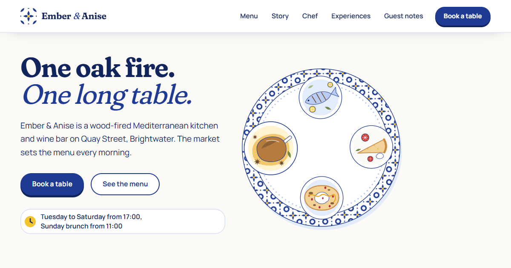

# Ember & Anise: free restaurant HTML template

A free, static HTML website template for restaurants, cafes and wine bars, by [WebArray](https://webarray.net). It ships with a fictional demo restaurant, **Ember & Anise**, a wood-fired Mediterranean kitchen, so you can see a complete, working site before you make it your own.

**Live demo:** https://shahbazb.github.io/webarray-starter/ember-anise/ (part of the [WebArray Starter](https://github.com/shahbazb/webarray-starter) collection)

It is a one-page site: hero, a "build the plate" scroll story, the menu, the story and chef, experiences, guest notes, reservations and the footer. No build tools, no frameworks, no backend.



---

## 1. Features

- **One page plus a 404 page.** Every section is reached from the top menu.
- **Plain HTML, CSS and JavaScript.** Open `index.html` and edit. Nothing to install or compile.
- **One place to theme it:** colors, fonts and layout sizes are CSS variables at the top of `assets/css/style.css`. The illustrations read the same variables, so a new palette recolors them too.
- **Hand-drawn style illustrations:** every picture is an inline SVG drawn for this template (a turning platter, 18 dishes, a market stall, the chef, postcards, a map). No stock photos.
- **Menu with filters:** dishes sit in categories; buttons filter the categories and each dish tile turns over to show its description.
- **Responsive:** tested at 1920, 1440, 1280 and 1024px desktop widths, 768px tablet and 390px and 360px phone widths.
- **Accessible defaults:** skip link, visible keyboard focus, labelled buttons and form fields, a logical heading order, text colors that meet WCAG AA contrast, and support for "reduced motion".
- **Animations with GSAP:** a platter that turns to present the signature dishes, ingredients that fly onto a plate as you scroll, flipping menu tiles, an awning that unrolls, cafe lights that switch on, postcards that fan out and speech bubbles that pop. If GSAP fails to load, or a visitor prefers reduced motion, every section still shows its content, just without motion.
- **Working mobile menu**, closable with the Escape key.
- **Booking form** with friendly validation and the real opening rules (closed Mondays, brunch times on Sundays). It runs in an honest demo mode until you connect a form service (see [Booking form](#14-known-limitations-and-the-booking-form)).
- **SEO basics:** page title, meta description, Open Graph and X (Twitter) tags, a social-sharing image, a favicon set and editable `Restaurant` structured data (schema.org).

## 2. Preview

- **Quickest:** double-click `index.html` to open it in your browser. Everything except the web fonts and animations works offline.
- **Recommended:** run a small local web server from the template folder, then open the address it prints:
  - Python: `python -m http.server 8000`, then visit `http://localhost:8000`
  - VS Code: install the "Live Server" extension, right-click `index.html`, then choose "Open with Live Server".

## 3. Folder structure

```
ember-anise/
├── index.html          The whole site, section by section
├── 404.html            "Page not found" page (used automatically by GitHub Pages)
├── assets/
│   ├── css/style.css   All styles; colors and fonts at the top
│   ├── js/main.js      Menu, filters, booking form and animations
│   └── images/         Favicon set and social-sharing image
├── README.md
└── LICENSE.txt
```

The illustrations are inside `index.html` as inline SVG, so they can use the colors from `style.css`. The shared pieces (the tile motif, lemon, leaf, awning pattern and menu icons) are in the `<svg class="sprite">` block at the top of the page.

## 4. Change the logo and restaurant name

1. **Name:** it appears in the header (`<span class="brand-name">`), the footer, the page title, the meta tags and the structured data. Use your editor's **Find and replace in files** to change `Ember &amp; Anise` (in HTML) and `Ember & Anise` (in the structured data) everywhere at once.
2. **Logo mark:** the small tile next to the name is `<svg class="brand-mark">`. Replace it with your own logo, for example ``.
3. **Favicon:** replace `assets/images/favicon.svg`, `favicon.ico` and `apple-touch-icon.png` (180 × 180 px). A free tool such as [RealFaviconGenerator](https://realfavicongenerator.net) can create them from your logo.

## 5. Edit text and links

- Open `index.html` in a text editor and change the words between the tags.
- Each section starts with a comment like `<!-- MENU TILE WALL ... -->` that explains what it is and how to change it.
- **Navigation:** the menu is in `<nav class="site-nav">`. Each link points to a section `id` (`#menu`, `#story`, `#chef`, `#experiences`, `#notes`, `#reserve`). The same list works on desktop and as the mobile menu.
- **Contact details:** search for `hello@example.com`, `+1 (555) 010-0148` and `tel:+15550100148`. They appear in the reservations section, the booking form messages, the footer and the structured data.
- **Opening hours:** they appear in the hero, the reservations section, the footer and the structured data. The booking form rules (closed Mondays, brunch on Sundays) are in `assets/js/main.js`: search for `Mondays` and `slots(11, 14.5)`.
- **Prices:** each price appears twice per dish: on the tile (`<span class="price-tag">$9</span>`) and in the hidden line read by screen readers (`<p class="sr-only">... Price $9.</p>`). Change both.

## 6. Add, duplicate, reorder or remove sections

Every section is a self-contained `<section> ... </section>` block with a comment above it.

- **Remove a section:** delete from its opening comment to its closing `</section>`, then remove its link from the menu. The animations skip anything that is missing.
- **Reorder:** cut a whole section and paste it elsewhere inside `<main>`.
- **Duplicate:** copy a whole section. If it has an `id`, give the copy a new, unique `id`.

Common edits:

| I want to... | Do this |
| --- | --- |
| Add a dish | Copy one `<li class="tile-item">` inside a category. Update the screen-reader line, the price, the name, the description on the back and the icon (`<use href="#i-...">`). |
| Change a dish picture | Each tile has `<svg class="dish">` with its drawing. Replace it with your own SVG, or with a photo: ``. |
| Add a menu category | Copy a whole `<section class="menu-cat">`, give it a new `data-cat` value and `id`, and add a filter button with the same `data-filter` value in `.chips`. Rows of three or four dishes fill the width automatically. |
| Change the platter dishes | The four dishes on the hero platter are the `.tp-dish` groups inside `.tp-platter`. Replace a drawing to change a dish. |
| Change "Build the plate" | Each ingredient is a group inside `#plate-svg` (`#ing-greens`, `#ing-bread` and so on) with a matching `<li>` in `.plate-steps`, in the same order. |
| Add an experience | Copy a `<article class="postcard-wrap">`. Its `--rest` value sets the resting tilt. |
| Add a guest note | Copy a `<figure class="bubble">`. Three notes fit one row on desktop. |
| Change the dividers | The striped awnings are `<svg class="awning">` and the string of lights is `<svg class="lights">`. Delete one to remove it, or copy it between any two sections. |

## 7. Colors and typography

Open `assets/css/style.css`. Everything is set in `:root` at the top:

```css
--whitewash: #FBFAF6;   /* page background */
--cobalt: #1F3A93;      /* buttons, lines, tiles */
--sea: #12245C;         /* main text, footer */
--lemon: #F4C430;       /* prices and highlights */
--olive: #5E7A2E;       /* leaves and herbs */
--font-display: "Fraunces", Georgia, serif;
--font-body: "Manrope", system-ui, sans-serif;
```

- The illustration colors (bread, crust, wood, pomegranate and so on) are listed just below the main palette. The SVG drawings use short class names such as `.k` (cobalt fill) and `.ln` (cobalt outline) that read these variables.
- Check text contrast with the [WebAIM contrast checker](https://webaim.org/resources/contrastchecker/): aim for at least 4.5:1.
- **Fonts:** pick fonts on [Google Fonts](https://fonts.google.com), replace the `<link href="https://fonts.googleapis.com/...">` line in `index.html` and `404.html`, then update `--font-display` and `--font-body`.
- **Self-hosting fonts:** if you prefer not to load fonts from Google (for example for privacy reasons), download them, put them in `assets/fonts/`, add `@font-face` rules to the CSS and remove the Google Fonts links.

### Animation

All motion is in `assets/js/main.js`, one block per effect, each with a comment (`HERO`, `BUILD THE PLATE`, `MENU`, `DIVIDERS` and so on). Delete a block to remove that effect.

- **Parallax:** any element with `data-speed="0.4"` drifts while the hero scrolls. Larger numbers move more; negative numbers move the other way.
- **Text reveals:** add `class="reveal-title"` to a heading to make its words rise, or `data-lines` to a paragraph to make its lines rise.
- To turn all motion off, delete the six GSAP `<script>` tags near the bottom of `index.html`. Visitors who set "reduce motion" in their operating system get a still version automatically.

## 8. Replace images

- The illustrations are inline SVG in `index.html`, each with a comment. To use photos instead, put them in `assets/images/` and swap the `<svg>` for an ``.
- Keep `width` and `height` on every ``. They stop the page from jumping while images load. Add `loading="lazy"` to images below the hero.
- **Alt text:** describe what the image shows (`alt="Whole sea bream with lemon and oregano"`). Use `alt=""` for purely decorative images.
- **Sizes:** export photos at about twice the size they appear on screen, and compress them (for example with [Squoosh](https://squoosh.app)).
- **Licenses:** only use images you own or have a license for. Photos found on other websites are usually not free to reuse. Free photo libraries such as Unsplash or Pexels have their own licenses: read them before using their photos, and keep a note of where each image came from.
- The illustrations and images included with this template were made for it and are MIT licensed, so you can use and modify them freely.

## 9. SEO and social sharing

In `index.html` (and the title and description in `404.html`), update:

1. `<title>` and `<meta name="description">`.
2. The Open Graph tags. Replace `https://example.com` with your real domain in `og:url` and `og:image`. Social networks need full URLs.
3. `assets/images/og-image.png`: the image shown when someone shares your link. Use 1200 × 630 px.
4. The `<script type="application/ld+json">` block: it describes the restaurant (name, address, phone, hours, cuisine) for search engines. Update every value, or delete the block. Test it with the [Schema Markup Validator](https://validator.schema.org).

Optional: add `<link rel="canonical" href="https://your-domain.com/">` once you know your final domain.

## 10. Deploy

### GitHub Pages (free)

1. Create a new repository on GitHub, for example `my-restaurant-website`.
2. Upload the *contents* of this folder (drag them onto the repository page, or use Git). `index.html` must be at the top level of the repository.
3. In the repository, go to **Settings → Pages**.
4. Under **Build and deployment**, choose **Deploy from a branch**, select the `main` branch and the `/ (root)` folder, then save.
5. After a minute or two, your site appears at `https://<your-username>.github.io/<repository-name>/`.

All paths in the template are relative, so it works from that sub-folder address.

### Other static hosts

Netlify, Cloudflare Pages, Vercel or any regular web host: upload the folder as-is. There is no build command and the output folder is the project root.

### Updating a live site

The page loads `assets/css/style.css?v=1` and `assets/js/main.js?v=1`. Browsers and hosts such as GitHub Pages cache these files, so visitors may keep seeing an old version for a while after you change them. When you edit the CSS or JavaScript, raise the number (`?v=2`, `?v=3`, ...) in `index.html` (and the CSS one in `404.html`) so browsers download the new file.

## 11. Dependencies and licenses

| Dependency | How it's loaded | License |
| --- | --- | --- |
| GSAP 3.13 (core, ScrollTrigger, SplitText, MorphSVG, DrawSVG, Flip) | jsDelivr CDN | [GSAP Standard License](https://gsap.com/standard-license): free, including commercial use. Read it before using GSAP in a product that competes with Webflow. |
| Fraunces, Manrope | Google Fonts | [SIL Open Font License 1.1](https://openfontlicense.org) |

No other libraries are used. To remove GSAP entirely, delete the six GSAP `<script>` tags at the bottom of `index.html`. The site keeps working without the animations.

## 12. Accessibility notes

- Interactive elements can be reached and used with the keyboard. Menu tiles turn over when focused, and Enter or Space turns them back.
- The menu filter announces what it shows to screen readers.
- Animations respect the operating system's "reduce motion" setting. The turning platter pauses when the pointer is over it.
- If you change colors, re-check contrast. If you add images, write alt text.

## 13. Browser support

Current versions of Chrome, Edge, Firefox and Safari, on desktop and mobile.

## 14. Known limitations and the booking form

- **The booking form does not send bookings yet.** It checks the fields (including closed Mondays and Sunday brunch times), then tells the visitor that it is a demo and gives the phone number. To receive bookings, use a form service. For example, with [Formspree](https://formspree.io):
  1. Create a free form on Formspree and copy its endpoint (for example `https://formspree.io/f/abcdwxyz`).
  2. In `index.html`, change the `<form id="booking">` tag to `action="https://formspree.io/f/abcdwxyz"` and `data-demo="false"`.
  3. Submit a test booking and confirm it arrives.

  A form service only sends you a message; it does not check table availability. For live availability, link the "Book a table" buttons to your booking system (for example OpenTable or Resy) instead. Read any service's privacy terms before collecting guest data.
- **Fonts and GSAP load from CDNs.** Offline, the site falls back to system fonts and no animation.
- **Demo content is fictional.** Replace the menu, prices, chef, guest notes, address and phone number before you publish. Never present sample reviews as real ones.
- **The 404 page uses relative links.** It works at the top level of your site. On GitHub Pages, a missing page several folders deep may show the 404 page without styles. To fix that, change the links in `404.html` to start with your site's path, for example `/your-repository-name/assets/css/style.css`.

---

Template by [WebArray](https://webarray.net). MIT licensed: see [LICENSE.txt](LICENSE.txt).
