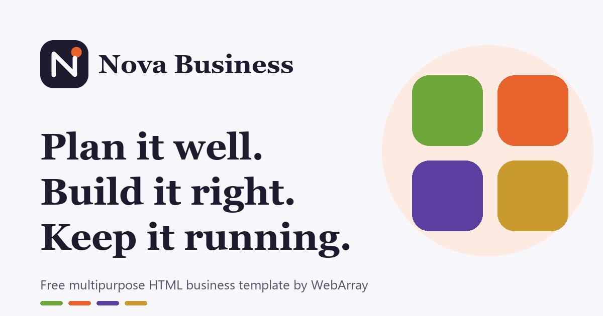

# Nova Business: free multipurpose HTML business template

A free, static HTML website template by [WebArray](https://webarray.net). It ships with a fictional demo company, **Nova Business**, so you can see a complete, working site before you make it your own.

**Live demo:** https://sb-blip.github.io/webarray-starter/nova-business/ (part of the [WebArray Starter](https://github.com/sb-blip/webarray-starter) collection)

It suits small and mid-sized businesses, agencies and consultants, professional services, restaurants and food businesses, health and wellness studios, product brands and startups. You adapt it by changing the text, images, colors and sections. No build tools, no frameworks, no backend.



---

## 1. Features

- **Five pages:** Home, Services, About, Contact and a 404 page.
- **Plain HTML, CSS and JavaScript.** Open `index.html` and edit. Nothing to install or compile.
- **One place to theme it:** colors, fonts, spacing and corner radius are CSS variables at the top of `assets/css/style.css`.
- **Color "tones":** each service or card gets one of five tones (`tone-1` to `tone-5`). Change a class to recolor it.
- **Responsive:** tested at desktop (1280px), tablet (768px) and phone (375px) widths.
- **Accessible defaults:** skip link, visible keyboard focus, labelled buttons, a logical heading order, text colors that meet WCAG AA contrast, and support for "reduced motion".
- **Animations with GSAP:** a hero that cycles through your services, a pinned services showcase, a process ring that draws itself, counters, swinging testimonial tags and a card deck. If GSAP fails to load, or a visitor prefers reduced motion, every section still shows its content, just without motion.
- **Working mobile menu** with a Services submenu, closable with the Escape key.
- **FAQ** built with native `<details>`, so it works without JavaScript.
- **Contact form** with friendly validation. It runs in an honest demo mode until you connect a form service (see [Contact form](#14-known-limitations-and-the-contact-form)).
- **SEO basics:** page titles, meta descriptions, Open Graph and X (Twitter) tags, a social-sharing image, favicon set and editable structured data (schema.org).
- **Original images:** all illustrations, the logo and icons were drawn for this template and are MIT licensed with the code.

## 2. Preview

- **Quickest:** double-click `index.html` to open it in your browser. Everything except the web fonts and animations works offline.
- **Recommended:** run a small local web server from the project folder, then open the address it prints:
  - Python: `python -m http.server 8000`, then visit `http://localhost:8000`
  - VS Code: install the "Live Server" extension, right-click `index.html`, then choose "Open with Live Server".

## 3. Folder structure

```
webarray-business-html-template/
├── index.html          Home page
├── services.html       Services, packages and reviews
├── about.html          Story, vision and mission, values, team
├── contact.html        Contact details and form
├── 404.html            "Page not found" page (used automatically by GitHub Pages)
├── assets/
│   ├── css/style.css   All styles; theme settings at the top
│   ├── js/main.js      Menu, form, testimonials and animations
│   └── images/         Logo, favicon, illustrations, social image
├── README.md
└── LICENSE.txt
```

## 4. Change the logo and business name

1. Replace `assets/images/logo.svg` with your own logo (a square SVG or PNG works best). If you use a different file name, update the `` in the header and footer of each page.
2. Replace the business name. It appears in the header (`<span class="brand__name">`), the footer, the page titles and the meta tags. Use your editor's **Find and replace in files** to change `Nova Business` everywhere at once.
3. Replace the favicon files in `assets/images/`: `favicon.svg`, `favicon.ico` and `apple-touch-icon.png` (180 × 180 px). A free tool such as [RealFaviconGenerator](https://realfavicongenerator.net) can create them from your logo.

## 5. Edit text and links

- Open any `.html` file in a text editor and change the words between the tags.
- Each major section starts with an HTML comment like `<!-- HERO: ... -->` that explains what it is and how to change it.
- **Navigation:** the main menu is in `<ul class="nav__links">`. The mobile menu is in `<div class="mobile-menu">`, just below it. The header is repeated on every page, so update all five files (Find and replace helps).
- **Buttons and links:** change the `href="..."`. Same-page anchors use `#id`, for example `href="index.html#faq"` jumps to the element with `id="faq"`.
- **Contact details:** search for `hello@example.com` and `+1 (555) 010-0123`. They appear in the mobile menu, footer, contact page and structured data.
- **Social links:** in the footer, replace `https://www.linkedin.com/` and `https://www.instagram.com/` with your profile URLs, or delete the lines.
- **Numbers:** in the "Since 2016 our team has delivered..." sentence, change both the visible number and the matching `data-count` value. The counter animates to `data-count`.

## 6. Add, duplicate, reorder or remove sections

Every section is a self-contained `<section> ... </section>` block with a comment above it.

- **Remove a section:** delete from its opening comment to its closing `</section>`.
- **Reorder:** cut a whole section and paste it elsewhere inside `<main>`.
- **Duplicate:** copy a whole section. If it has an `id`, give the copy a new, unique `id`.

Common edits:

| I want to... | Do this |
| --- | --- |
| Add a service on the home page | Copy one `<article class="sheet">` inside `.showcase`, and one `<li>` in the `service-rows` list. Update the hero images too if you want it in the cycle. |
| Add a service detail block | Copy one `<article class="service-detail">` on `services.html` and give it a new `id`. |
| Add or remove a package, product or menu item | Copy or delete a `<article class="card">` in the packages grid. |
| Add a testimonial | Home: copy a `<li class="tag">`. Services and About: copy a `<figure class="deck-card">`. |
| Add an FAQ | Copy a `<details class="faq__item">`. If you keep the FAQ structured data in the `<head>` of `index.html`, add the question there too. |
| Add a team member | Copy a `<article class="team-card">` on `about.html`. |
| Change a card's color | Change its `tone-1` ... `tone-5` class. |

**Turning "services" into something else:**

- **Portfolio:** use the `service-detail` blocks for case studies. Put a project image in the media column, the client and brief in the text, and results only if you can back them up.
- **Product showcase:** use the package cards for products. The title is the product name, the paragraph describes it, the checklist holds features, and the button links to the product.
- **Restaurant menu:** use the cards for menu sections (Breakfast, Lunch, Drinks) and the checklist for dishes.
- **Health and wellness:** treatments become services; the process ring becomes "your first visit".

## 7. Colors and typography

Open `assets/css/style.css`. Everything is set in `:root` at the top:

```css
--color-ink: #1e1b2e;        /* text, dark sections, primary buttons */
--color-paper: #f7f7fb;      /* page background */
--color-accent: #e8622c;     /* focus ring and highlights */
--tone-1: #6fa83a; --tone-1-ink: #3f6b1c; --tone-1-tint: #eef6e3;
--font-display: "Young Serif", Georgia, serif;
--font-body: "Schibsted Grotesk", system-ui, sans-serif;
```

- A **tone** has three colors: `--tone-N` (shapes and dots), `--tone-N-ink` (text; keep it dark enough to read on white) and `--tone-N-tint` (a pale background). Check contrast with the [WebAIM contrast checker](https://webaim.org/resources/contrastchecker/): aim for at least 4.5:1 for text.
- **Fonts:** pick fonts on [Google Fonts](https://fonts.google.com), replace the `<link href="https://fonts.googleapis.com/...">` line in every page, then update `--font-display` and `--font-body`.
- **Self-hosting fonts:** if you prefer not to load fonts from Google (for example for privacy reasons), download them, put them in `assets/fonts/`, add `@font-face` rules to the CSS and remove the Google Fonts links.

### Animation and parallax

Motion is controlled with plain HTML attributes, so you can add or remove it without touching JavaScript:

| Attribute | Effect | Example |
| --- | --- | --- |
| `data-parallax="0.3"` | Moves at its own speed while the page scrolls. Larger numbers move more; negative numbers move the other way. | `` |
| `data-float` | Bobs gently up and down. | `` |
| `data-tilt` | Tilts in 3D toward the mouse pointer (mouse devices only). | `<article class="card" data-tilt>` |
| `data-pulse` | Breathes in and out. | `<span data-pulse></span>` |
| `data-reveal` | Fades up when scrolled into view. Use `data-reveal="scale"` to grow in, `"wipe"` to wipe open from the left, or `"lines"` to make text rise line by line. | `<p data-reveal="lines">` |
| `data-stagger` | Its children appear one after another. Use `data-stagger="pop"` to pop them in, or `"grow"` to grow them from the left. | `<ul data-stagger>` |

Also automatic:
- section headings (`.section .h2`) rise line by line;
- main buttons lean slightly toward the pointer;
- a progress bar along the top shows how far down the page you are.

To turn all motion off, delete the five GSAP `<script>` tags. Visitors who set "reduce motion" in their operating system get a still version automatically.

## 8. Replace images

- All images are in `assets/images/`. Replace a file with your own and keep the same name, or change the `src`.
- Keep the `width` and `height` attributes on `` tags. They stop the page from jumping while images load. Update them to your image's real size.
- **Alt text:** describe what the image shows (`alt="Our team at the spring workshop"`). Use `alt=""` for purely decorative images.
- **Sizes:** illustrations in the hero and services are square (400 × 400 px or larger). Export photos at about twice the size they appear on screen, and compress them (for example with [Squoosh](https://squoosh.app)).
- **Licenses:** only use images you own or have a license for. Photos found on other websites are usually not free to reuse. Free photo libraries such as Unsplash or Pexels have their own licenses: read them before using their photos, and keep a note of where each image came from.
- The images included with this template were drawn for it and are MIT licensed, so you can use and modify them freely.

## 9. SEO and social sharing

On **every page**, update:

1. `<title>` and `<meta name="description">`.
2. The Open Graph tags. Replace `https://example.com` with your real domain in `og:url` and `og:image`. Social networks need full URLs.
3. `assets/images/og-image.png`: the image shown when someone shares your link. Use 1200 × 630 px.

On `index.html`, update or delete the two `<script type="application/ld+json">` blocks (business details and FAQ). Test them with the [Schema Markup Validator](https://validator.schema.org).

Optional: add a `<link rel="canonical" href="https://your-domain.com/page.html">` to each page once you know your final domain.

## 10. Deploy

### GitHub Pages (free)

1. Create a new repository on GitHub, for example `webarray-business-html-template`.
2. Upload the files (drag them onto the repository page, or use Git). `index.html` must be at the top level of the repository.
3. In the repository, go to **Settings → Pages**.
4. Under **Build and deployment**, choose **Deploy from a branch**, select the `main` branch and the `/ (root)` folder, then save.
5. After a minute or two, your site appears at `https://<your-username>.github.io/<repository-name>/`.

All paths in the template are relative, so it works from that sub-folder address.

### Other static hosts

Netlify, Cloudflare Pages, Vercel or any regular web host: upload the folder as-is. There is no build command and the output folder is the project root.

### Updating a live site

Each page loads `assets/css/style.css?v=2` and `assets/js/main.js?v=2`. Browsers and hosts such as GitHub Pages cache these files, so visitors may keep seeing an old version for a while after you change them. When you edit the CSS or JavaScript, raise the number (`?v=3`, `?v=4`, ...) in every page so browsers download the new file.

## 11. Dependencies and licenses

| Dependency | How it's loaded | License |
| --- | --- | --- |
| GSAP 3.13 (core, ScrollTrigger, SplitText, MorphSVG, DrawSVG) | jsDelivr CDN | [GSAP Standard License](https://gsap.com/standard-license): free, including commercial use. Read it before using GSAP in a product that competes with Webflow. |
| Young Serif, Schibsted Grotesk | Google Fonts | [SIL Open Font License 1.1](https://openfontlicense.org) |

No other libraries are used. To remove GSAP entirely, delete the five GSAP `<script>` tags at the bottom of each page. The site keeps working without the animations.

## 12. Accessibility notes

- Interactive elements can be reached and used with the keyboard. The testimonial deck responds to the arrow keys when focused.
- Animations respect the operating system's "reduce motion" setting.
- If you change colors, re-check contrast. If you add images, write alt text.

## 13. Browser support

Current versions of Chrome, Edge, Firefox and Safari, on desktop and mobile.

## 14. Known limitations and the contact form

- **The contact form does not send messages yet.** It validates the fields, then tells the visitor that it is a demo. To receive messages, use a form service. For example, with [Formspree](https://formspree.io):
  1. Create a free form on Formspree and copy its endpoint (for example `https://formspree.io/f/abcdwxyz`).
  2. In `contact.html`, change the `<form>` tag to `action="https://formspree.io/f/abcdwxyz"` and `data-demo="false"`.
  3. Submit a test message and confirm it arrives.

  Other services such as Basin, Getform or Netlify Forms work in a similar way. Read their privacy terms before collecting visitor data.
- **The header and footer are repeated in every page.** A static site has no shared include, so update all five pages when you change the menu or footer.
- **Fonts and GSAP load from CDNs.** Offline, the site falls back to system fonts and no animation.
- **Demo content is fictional.** Replace the testimonials, team, numbers and contact details before you publish. Never present sample reviews as real ones.
- **The 404 page uses relative links.** It works at the top level of your site. On GitHub Pages, a missing page several folders deep may show the 404 page without styles. To fix that, change the links in `404.html` to start with your site's path, for example `/your-repository-name/assets/css/style.css`.

---

Made by [WebArray](https://webarray.net). MIT licensed: see [LICENSE.txt](LICENSE.txt).
